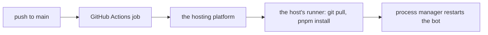

# Contributing

How to run ArchiveBot locally, where things live, what checks a change must
pass, and how it reaches production. What it does for a user is in
[features.md](features.md).

## Run it locally

Node.js, a Discord application and bot token, and `pnpm` (the repo commits a
`pnpm-lock.yaml`, and the deploy installs with it even though the package
manager isn't npm or yarn — see `package.json`).

```sh
pnpm install
node index.js      # runs the bot against whatever .env / Discord app you point it at
npm test           # jest
npm run test:coverage
```

A local `.env` (via `dotenv`) is a dev convenience only. Production config is
injected by the process manager from a shared secret store. The bot also
refuses to start against a configured output directory that doesn't already
exist on disk, rather than silently recreating an empty one.

## Architecture

| Path                         | What it is                                                                                 |
| ----------------------------- | ------------------------------------------------------------------------------------------- |
| `index.js`                   | Discord client setup, slash-command dispatch, the webhook server, graceful shutdown         |
| `commands.js`                | every slash command's definition and handler                                               |
| `lib/archive.js`              | channel/server archiving, attachment storage keyed by id                                    |
| `lib/archiveRepair.js`        | recovering attachments an older filename-only save let overwrite                            |
| `lib/tasklist.js`              | the per-server task board                                                                   |
| `lib/scheduler.js`            | reminders and Discord scheduled events                                                      |
| `lib/colorroles.js`           | per-server colour-role management                                                           |
| `lib/permissions.js`          | per-server admin/task access, by list or by role name                                       |
| `lib/cardtableSetup.js`       | `/setup layout:cardtable` and the guild layout it converges on                              |
| `lib/cardtableMembers.js`     | linked members' **Linked** role and nickname                                                 |
| `lib/meetingSpace*.js`        | disposable, invite-gated private meeting spaces (category + two channels + role)            |
| `lib/dataStore.js`            | client for the archive's off-host system of record                                          |
| `lib/stateSync.js`, `storeRestore.js`, `reconcile.js`, `heldLease.js`, `central.js` | the off-host state sync, restore-on-boot, and hot-standby lease |
| `lib/webhookServer.js`        | the HTTP server behind `/api/events/*`, `/api/messages/*`, `/api/discord/*`                 |
| `lib/ledger.js`               | mirrors activity and failures out to a shared events feed                                   |
| `utils/logger.js`             | a thin adapter over the shared ecosystem logger, `key=val` lines                            |

Everything a guild writes through this bot — archives, scheduler items,
permissions, colour roles, the task list — lives under one output root
(`lib/paths.js`'s `outputPath()`), never a literal `'Output'` string, so the
root can be redirected without hunting down every call site.

**Command dispatch order.** `interactionCreate` in `index.js` checks a
command against `adminCommandsList` before it checks the command's own
category. `createCommandsList()` (`commands.js`) returns every admin AND
task command in one object, so a task command (`/task`, `/done`, `/take`,
`/tag`, `/delete`, `/history`) matches the admin check first and is gated on
full admin access (`index.js:286-291`) before the task-only check
(`index.js:308`, `permissions.checkTaskAccessWithRoles`) is ever reached. A
narrower "task" grant (`/assign type:Task`) is stored but never actually
consulted for these six commands.

**Off-host state.** The archive's system of record is an external data
store, reached through `lib/dataStore.js`; the local database and files are
a rebuildable cache. On boot, `lib/storeRestore.js` fills in anything
missing locally (state, a guild's archive, the import manifest) from that
store, so a fresh host starts from nothing but the network. `lib/stateSync.js`
pushes the bot's working state (scheduled items, cardtable/meeting-space
state, the task list) up every ten minutes; a running bot never reads its own
state back from the store, so reminders keep firing even if the store is
down.

**Hot standby.** Setting the bot to centralized mode takes a renewable lease
(`lib/heldLease.js`) before logging into Discord at all — a process without
the lease never logs in, so two copies can never both post the same
reminder. Losing the lease destroys the Discord client and exits with a
distinct code so the process manager restarts it as a standby; a clean
shutdown instead flushes state and hands the lease back so a waiting
standby can take over immediately. `/health` reports which of these states
the process is in.

## Tests and gates

```sh
npm test               # jest
npm run test:coverage
```

Tests that exercise the off-host data store and the hot-standby lease run
against a real local instance of that store's own server rather than a
mock, and fail — rather than skip — when it isn't available.



A push to `main` runs a GitHub Actions workflow that asks the hosting
platform, through this repo's own service credential, to redeploy. The repo
holds no credential that can write anywhere else. The actual deploy pulls
the new commit, installs with the frozen lockfile, and restarts the bot
under its process manager. A dependency bump that isn't matched by a
committed lockfile change fails that last step.

## Trivia

Moving off npm added a seven-day cooldown before any newly published outside
package can be installed at all, long enough for the wider ecosystem to catch
a malicious release. This repo's own `@wolffm/*` dependencies are exempted,
so the cross-repo update path still installs them immediately (`f9a8ed5`).
